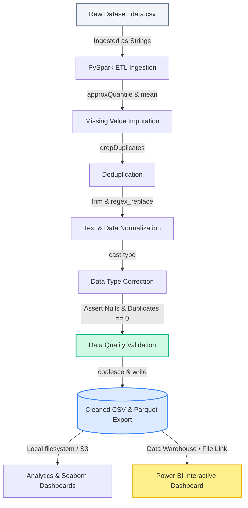

# Enterprise Data Pipeline: PySpark ETL, Data Quality Auditing, & Analytics Layer
[](https://spark.apache.org/)
[](https://www.python.org/)
[](https://jupyter.org/)

An end-to-end data engineering and analytics pipeline utilizing **Apache Spark (PySpark)** for ingestion, cleansing, statistical imputation, deduplication, and schema validation of transactional datasets. This project is built to resemble a production enterprise architecture, including programmatic quality checks, localized Python executive dashboards, and a complete Power BI deployment blueprint.

---

## 1. System Architecture

The following diagram illustrates the flow of raw transactional data through our ETL pipeline into validated analytical assets and executive visualization layers:



---

## 2. Pipeline Features & Implementation

### A. PySpark Distributed Cleansing
* **Type Ingestion Control**: Loaded with `inferSchema=False` to prevent loss of malformed currency symbols and ensure accurate string-level cleaning.
* **Missing Value Imputation**: Implements robust, non-distorting statistical rules:
  * **Numerical fields**: Imputed using median (`Age` via `approxQuantile` to prevent outlier skew) and mean (`Annual Income`, `Store Rating`, `Purchase Amount`).
  * **Categorical fields**: Imputed using mode (`Gender`) and default placeholders (`City`).
  * **Date fields**: Imputed using default date fallback (`Transaction Date` -> `2023-01-01`).
* **Deduplication**: Identifies and purges duplicate entries, tracking counts before and after de-duplication.
* **Standardization**: Trims whitespace, maps mixed-casing (e.g. `female`/`FEMALE`/`female` -> `Female`), strips formatting characters (e.g. currency `$` and commas), and enforces uniform `snake_case` column headers.
* **Programmatic Quality Gates**: Applies hard assertions verifying that zero nulls or duplicates remain before writing out the target tables.

### B. Integrated Analytics & Python Dashboards
* **Data Quality Dashboard**: Visualizes missing value counts per field, deduplication breakdown, and a **Data Completeness Profile** (Pre vs. Post cleaning) with a computed **Data Quality Improvement Index (DQII)**:
  $$\text{DQII \%} = \frac{\text{Nulls Imputed} + (\text{Duplicates Purged} \times \text{Columns})}{\text{Total Cells in Raw Dataset}} \times 100$$
* **Business Insights Dashboard**: Features executive KPIs (Net Sales, AOV, Avg Rating), sales contribution by market (City), customer demographic segmentation, and a regression plot correlating customer age with basket size.

---

## 3. Repository File Structure

```text
pyspark-data-cleaning/
├── README.md                 # Project architecture and documentation
├── requirements.txt          # Python packages (PySpark, Matplotlib, Seaborn, Pandas)
├── data.csv                  # Dirty transactional dataset
├── cleaned_data.csv/         # Unified CSV output folder
├── cleaned_data.parquet/     # Production-grade columnar Parquet output
├── data_quality_dashboard.png# Rendered Data Quality visual audit
├── business_insights_dashboard.png# Rendered Executive Business dashboard
├── build_notebook.py         # Notebook compilation utility script
├── dashboard.py              # Interactive Streamlit Web Application
├── pyspark_assignment.ipynb  # Interactive Jupyter Notebook showcasing the pipeline
└── pyspark_assignment.py     # Executable Python script version of the ETL pipeline
```


---

## 4. Getting Started

### Prerequisites
* **Python**: Python 3.10+ recommended.
* **Java JRE/JDK**: PySpark requires Java installed and configured (`JAVA_HOME` environment variable set).

### Installation
1. Clone the repository:
   ```bash
   git clone https://github.com/lazyasz/pyspark-data-cleaning.git
   cd pyspark-data-cleaning
   ```
2. Install the required libraries:
   ```bash
   pip install -r requirements.txt
   ```

### Execution
* **To compile/regenerate the Jupyter Notebook**:
  ```bash
  py build_notebook.py
  ```
* **To run the ETL pipeline & generate PNG Dashboards**:
  ```bash
  py pyspark_assignment.py
  ```
* **To run the Streamlit Interactive Dashboard (Web App)**:
  ```bash
  py -m streamlit run dashboard.py
  ```
* **To open the interactive notebook**:
  ```bash
  jupyter notebook
  ```
  Open `pyspark_assignment.ipynb` to view the cell executions, markdown analysis, and diagrams.

---

## 5. Enterprise Power BI Blueprint

To extend this pipeline into a BI tool, follow this design plan:

### Page 1: Data Quality Audit
* **KPI Cards**: Total Ingested Rows, Rows Purged, Data Completeness Index, Data Sparsity Ratio.
* **Stacked Bar Chart**: Null count pre-clean vs. post-clean per column.
* **Donut Chart**: Record Type Distribution (Unique Clean records vs. Duplicates Removed).
* **Alert Matrix**: Grid showing column health indicators (Complete/Incomplete/Imputed).

### Page 2: Commercial & Customer Summary
* **KPI Cards**: Net Revenue ($), Average Order Value (AOV), Sales Volume (Count), Avg Rating.
* **Clustered Bar Chart**: Revenue by City (Market split).
* **Scatter Plot**: Purchase Amount (Y) vs. Age (X) with trend line and segmentation filters.
* **Donut Chart**: Revenue Share % by Gender.

### Core DAX Measures
```dax
// 1. Data Quality Index
DQI = (COUNTROWS(CleanedData) * DISTINCTCOUNT(CleanedData[transaction_id])) / (COUNTROWS(RawData) * DISTINCTCOUNT(RawData[transaction_id]))

// 2. Average Order Value (AOV)
AOV = SUM(CleanedData[purchase_amount]) / COUNT(CleanedData[transaction_id])

// 3. Customer Lifetime Value Proxy (CLV)
CLV_Proxy = [AOV] * (COUNT(CleanedData[transaction_id]) / DISTINCTCOUNT(CleanedData[customer_name]))
```

---

## 6. Professional Visual & Presentation Recommendations

When showcasing this project to recruiters, professors, or clients, include the following visual assets:
1. **Schema Evolution Comparison**: Screenshot the schema structure change before vs after casting (`df_raw.printSchema()` vs `df_typed.printSchema()`).
2. **Pipeline Architecture Diagram**: Embed the Mermaid flowchart from Section 1 in your slides.
3. **Data Quality Dashboard**: Include `data_quality_dashboard.png` to prove validation-first design.
4. **Business Summary Dashboard**: Include `business_insights_dashboard.png` showcasing statistical insights like customer demographic clusters and sales distributions.
5. **Interactive Power BI Slicing**: Show a screen recording of your Power BI dashboard reacting to filters (e.g. slicing by Chicago or Miami).
