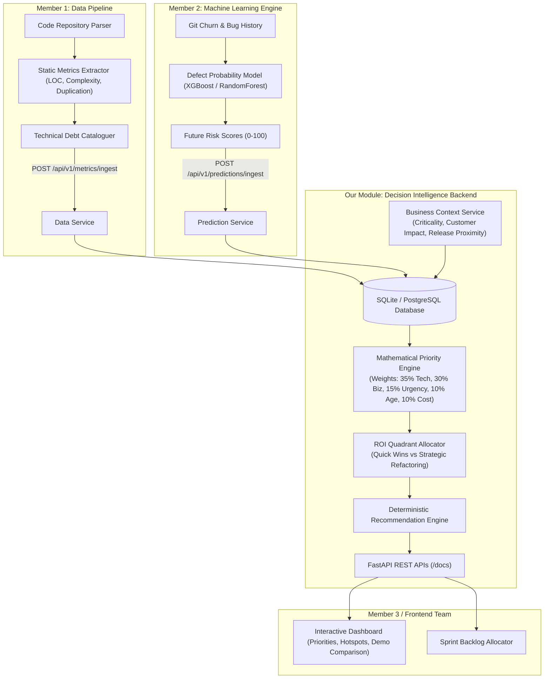

# System Architecture & Integration Guide

## 1. Executive Summary
The **Predictive Engineering Intelligence Platform** is a business-aware decision intelligence system designed to solve a fundamental challenge in software engineering: **Technical Debt Prioritization**. 

Traditional static analysis tools (e.g., SonarQube, CodeClimate) identify code smells and complexity metrics in isolation. However, they lack business context and future failure risk. This platform synthesizes:
1. **Static Technical Risk** (Member 1: Code Metrics & Debt)
2. **Predicted Future Defect Risk** (Member 2: ML Models)
3. **Business Context & Operational Exposure** (Our Module: Decision Engine)
4. **Release/Sprint Proximity & Remediation ROI** (Our Module: Recommendation Logic)

---

## 2. Multi-Member System Workflow



---

## 3. Modular Service Architecture

The backend follows clean layered architecture principles:

```
backend/
├── api/                   # REST API Routers (Separation of concerns)
│   ├── routes.py          # Unified router
│   ├── repositories_routes.py
│   ├── metrics_routes.py
│   ├── predictions_routes.py
│   ├── business_routes.py
│   └── priority_routes.py
├── database/              # Persistence Layer
│   ├── connection.py      # SQLAlchemy engine & session dependency
│   └── models.py          # Relational entities
├── schemas/               # Validation Layer (Pydantic v2)
│   ├── repository.py
│   ├── metrics.py
│   ├── prediction.py
│   ├── business_context.py
│   ├── priority.py
│   └── recommendation.py
├── services/              # Business Logic & Decision Engines
│   ├── data_service.py
│   ├── prediction_service.py
│   ├── business_service.py
│   ├── priority_service.py
│   ├── recommendation_service.py
│   └── seed_service.py
├── tests/                 # Automated Pytest Suite
└── config.py              # Environment configuration
```

---

## 4. Integration Specifications

### How Member 1 (Data Pipeline) Integrates:
1. Member 1 extracts repository code and parses AST / static metrics.
2. Member 1 calls `POST /api/v1/metrics/ingest` with cyclomatic complexity, code smells, duplication percentage, and test coverage.
3. Member 1 calls `POST /api/v1/technical-debt` to log specific debt findings (e.g., God class, missing edge case tests).

### How Member 2 (ML Engine) Integrates:
1. Member 2 trains risk prediction models (e.g. XGBoost, RandomForest) on historical commit logs and bug trackers.
2. Member 2 pushes outputs using `POST /api/v1/predictions/ingest` or `POST /api/v1/predictions/batch-ingest`.
3. Our decision intelligence backend blends their `predicted_future_risk` with static code metrics.

### How Frontend / Team UI Integrates:
1. The frontend team fetches prioritized remediation queues via `GET /api/v1/priorities`.
2. The frontend team renders deep-dive file modal cards using `GET /api/v1/files/{file_id}`.
3. The frontend showcases the project's core differentiator via `GET /api/v1/comparison/demo`.
